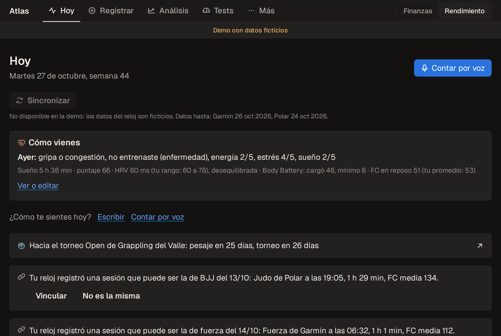
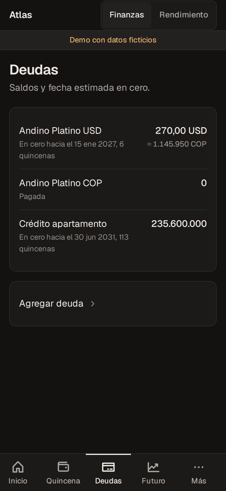
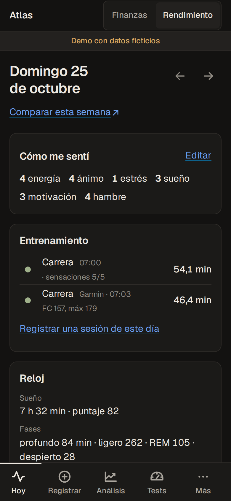
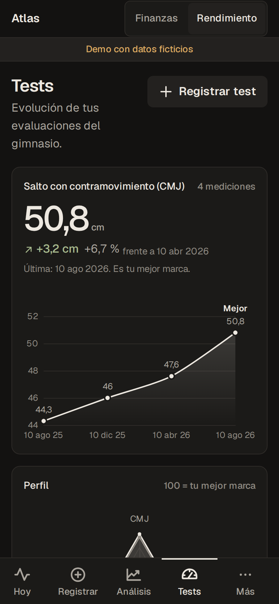
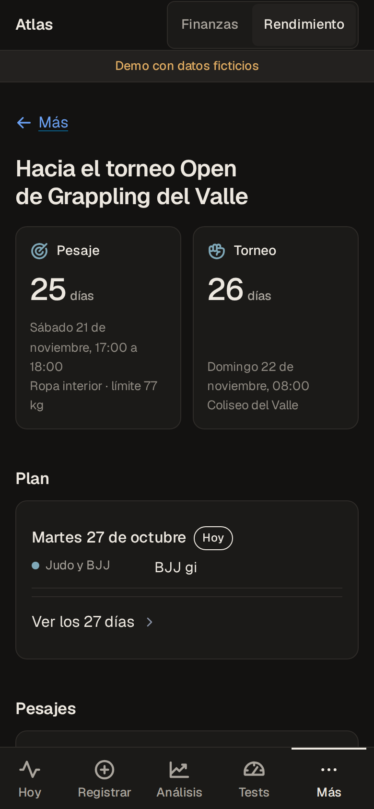

<div align="center">

# Atlas

**Your money and your training, in one private app.**

A local-first web app that splits each paycheck into envelopes, drives debts to zero and tracks strength, combat sports, running, sleep and recovery. AI agents read the data and help, but they work inside tight, tested boundaries.




</div>

---

## What it does

| Module | What happens |
| --- | --- |
| **Paycheck** | Enter the net pay and pick a template. Atlas splits it into envelopes (home, card, savings, free money), asks for the amounts it cannot know and will not confirm until every peso is assigned. |
| **Debts and goals** | Debts in COP and USD with the exchange rate of the day, estimated payoff dates, savings goals tied to real accounts and sinking funds that add their own line to each paycheck. |
| **Future** | A 12 or 24 month projection with known events (bonuses, severance), editable scenarios and an avalanche vs snowball comparison, drawn with ECharts. |
| **Training** | Strength sets, judo, BJJ and muay thai rounds with techniques, runs, physical tests and body composition. Sessions recorded by the watch are matched to what you logged. |
| **Recovery** | Sleep, HRV, resting heart rate and Body Battery from Garmin and Polar, plus how you felt each day (energy, mood, stress, symptoms), in a day view and a 14 day history. |
| **Voice logging** | Say what you ate and trained. Speech is transcribed locally and turned into a draft that you review field by field before anything is saved. |
| **Competition prep** | Countdown to weigh-in and tournament, the day by day plan, weigh-ins and a checklist for the day. |

<div align="center">





<sub>Screens from the demo: James Restrepo and every number shown are fictional.</sub>
</div>

### Honest AI by design

- **Nothing invented.** The voice agent has no tools and can only answer inside a strict JSON schema. Every number it returns is checked against the transcript: a value that was never said stays empty, and a number that does not match what was heard is flagged for review in the draft.
- **Inference is labeled.** Weekly and combat analyses tag every recommendation as an inference and never stand in for the coach, physio or nutritionist.
- **The notes vault is read only.** Agents read a Markdown knowledge base; the only writes allowed are new import files in one folder, and the app checks that after every run.

## Agentic architecture

```
 phone (htmx) ──► FastAPI ──► SQLite
                     │
                     ├─► AI job queue (one job at a time: queued, running, done, failed)
                     │      │
                     │      ├─ analysis agents ─ read only tools, no MCP, no shell
                     │      ├─ sync agent ────── Garmin MCP + read only Polar tools, writes only to imports/
                     │      ├─ backfill agent ── Garmin MCP, writes only to imports/garmin/, 30 min cap
                     │      ├─ voice agent ───── no tools, JSON schema output
                     │      └─ image agent ───── read only sandbox, ephemeral session, JSON schema output
                     │
                     └─► local speech to text (faster-whisper): audio never leaves the laptop
```

- **Headless agents in a job queue.** Each AI task is a row in `trabajos_ia` and runs as a headless agent process on a background thread. The queue takes one job at a time behind a lock, jobs cut off by a restart are marked failed on boot, and the UI shows live status with htmx polling.
- **Tools scoped per job type.** Analyses get only `Read`, `Grep` and `Glob`. Sync gets the Garmin MCP, an allow list of read only Polar tools and write access limited to `imports/**`. MCP servers are passed with a strict per-run config, written to a temp file with `0600` permissions and deleted afterwards. See [`trabajos.py`](app/modules/rendimiento/trabajos.py).
- **Verified side effects.** After a sync, `git status` of the vault must show no change outside `imports/`, and an mtime and size snapshot proves that no existing import file was touched. Otherwise the job fails and reports the paths that changed.
- **Hard time limits.** Every agent run has a timeout (15 minutes by default through `BRAIN_TIEMPO_MAX`, 30 minutes for the health backfill), errors come back as readable messages and the agent log is stored with the job.
- **Exports for other agents.** `make resumen-ia` and `make resumen-rendimiento` write versioned JSON and Markdown summaries, so an external agent can read the data without a prompt full of numbers ([docs/](docs/)).

## Privacy and security by design

- **Local first.** Data lives in a local SQLite file; photos, exports, `.env` and real seeds are git ignored. The app is served on the home network through Caddy and mDNS, behind a PIN and a signed, time limited session cookie.
- **An isolated demo.** `BRAIN_DEMO=1` comes only from the environment. On boot the demo resolves every data path, following symlinks, and refuses to start if any of them leaves `demo/datos/` or points at the real app's data. It has its own port, PIN and cookie name.
- **External services off in the demo.** Sync, analyses, image generation, voice and writes to the vault are disabled at the route and again inside the job runner; they answer `409` with "No disponible en la demo".
- **Tested, not promised.** The demo suite checks config isolation and symlinks, blocks every external action with subprocess patched to fail, and asserts that no forbidden word (real names, companies, banks) appears in the database or in any rendered page.

## How it was built

**Spec Driven Development with agents.** Every feature started as a written spec with GIVEN / WHEN / THEN scenarios, a task list and the decisions taken while building. Each spec went through an adversarial review whose only goal was to break it before any code was written, and the tests follow the spec scenarios. The specs stay private because they describe a real person's finances and health.

**Verification as a gate.** A change is done when the full pytest suite passes (fake agent CLIs, a fake transcriber, a fictional vault in a temp folder, no network) and Playwright shows no horizontal overflow, 44 px touch targets and no console errors at 360 px and on desktop.

## Run the demo

Requires Linux or macOS, [uv](https://docs.astral.sh/uv/) and Python 3.12 or newer.

```sh
git clone https://github.com/cr-montoya/atlas.git && cd atlas
make demo-crear   # dependencies and the demo .env
make demo-reset   # reproducible fictional database, notes vault and photos in demo/datos/
make demo-run     # open http://127.0.0.1:8010 and use PIN 2468
```

The seed is reproducible: the same date and seed always give the same data (`make demo-reset FECHA=2026-10-27 SEMILLA=2026`). More in [demo/README.md](demo/README.md).

## Tests

```sh
make test         # 550 tests with pytest
```

| Area | What is covered |
| --- | --- |
| Finances | Paycheck split and balance check, debts in two currencies, projections, scenarios, sinking funds, Colombian money format |
| Training | Strength load math, combat logging, watch matching and dedupe across devices, tests and body composition read from the vault |
| Agents | Exact command lines and tool lists per job type, timeouts, queue states, restart recovery, side effect guards |
| Voice | Schema validation, numbers checked against the transcript, negation and symptom synonyms, single transaction save |
| Demo | Path isolation, blocked external actions, reproducible seed, forbidden words in data and pages |

## Stack

| Layer | Technology |
| --- | --- |
| Backend | Python 3.12+, FastAPI, Jinja2, itsdangerous |
| Data | SQLite with plain SQL migrations; money as integers (pesos and USD cents), never floats |
| Frontend | Server rendered HTML, htmx, Pico CSS, ECharts; no JavaScript build step; mobile first ([DESIGN.md](DESIGN.md)) |
| AI | Headless agent CLIs with scoped tools, MCP servers for Garmin and Polar, faster-whisper for local speech to text |
| Images | Pillow for photo handling and the demo's generated silhouettes |
| Ops | systemd user services with `Restart=always`, Caddy reverse proxy, mDNS aliases ([deploy/](deploy/)) |
| Tests | pytest, Playwright |

## Repository layout

```
app/core/        config, PIN auth, database and migrations, base templates and static files
app/modules/     finanzas and rendimiento: routes, queries, logic, agent jobs and templates
app/demo/        reproducible seed for the fictional demo
deploy/          systemd units, Caddyfile and mDNS alias script
docs/            AI export formats and screenshots
tests/           pytest suite, fake agent CLIs and a fictional notes vault
```

## Key decisions

| Decision | Why |
| --- | --- |
| Server rendered HTML with htmx | One language, no build step and fast on a phone; live job status is a polled fragment |
| SQLite and integers for money | One file to back up hot, and no rounding errors in pesos or USD cents |
| Agents as scoped subprocesses | Each job gets the smallest tool set it needs, a timeout and a log, and its side effects are checked afterwards |
| Local speech to text | Voice notes about health and food never leave the laptop; only the text reaches the agent |
| A demo that refuses to start | Isolation is checked on boot and in tests instead of relying on careful configuration |

## License

All rights reserved. This code is published as a portfolio sample of a personal project.

---

<div align="center">

Built with specs, scoped agents and a lot of tests by [Cristian Montoya](https://github.com/cr-montoya).

</div>
